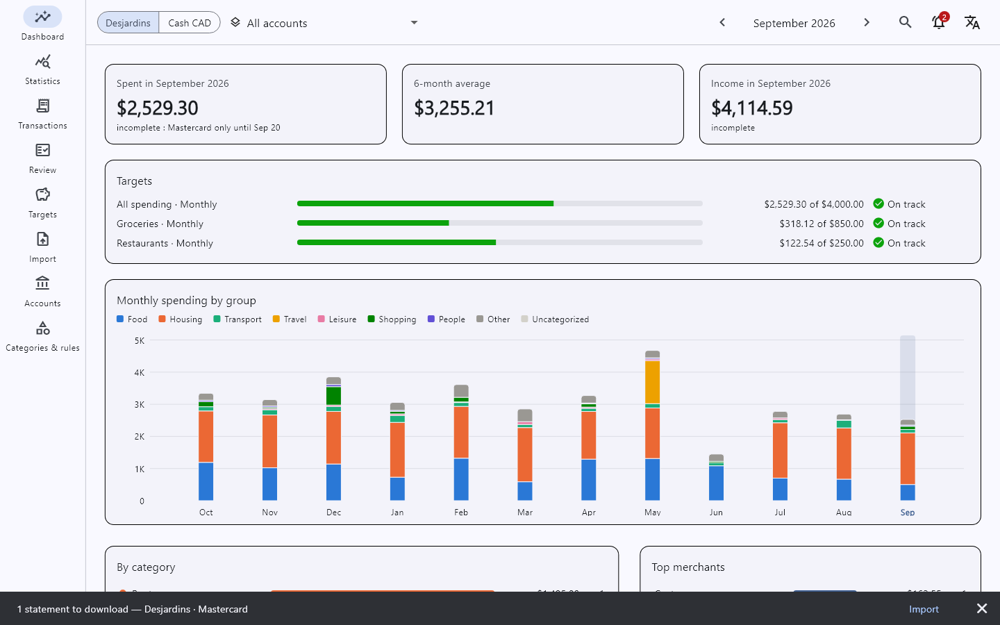
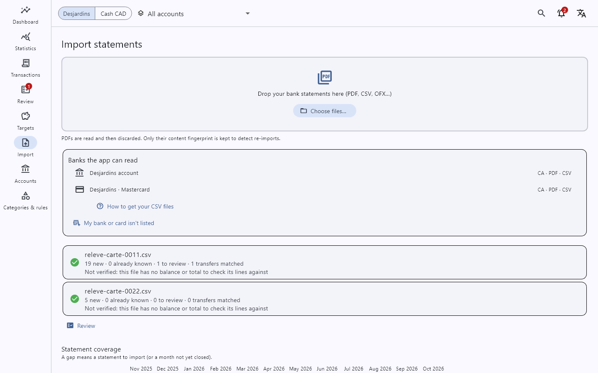
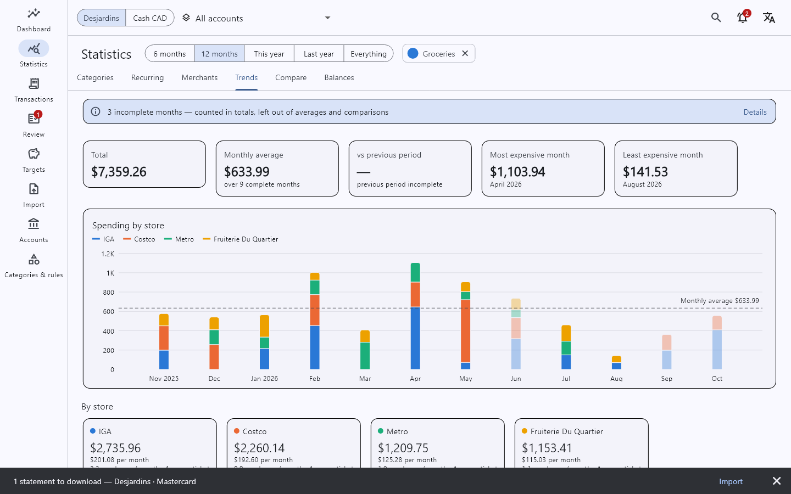
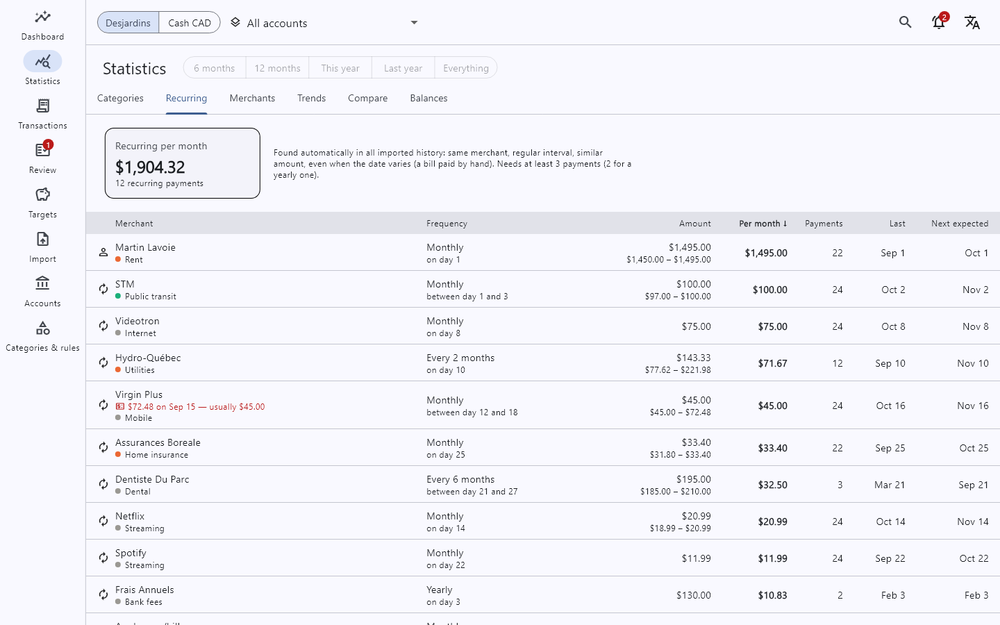

# Dépenses — expense tracker

See where your money goes **without typing your expenses**. Download your bank's transactions, drop the file on
the app, and it sorts every line into categories (groceries, restaurants, rent, transport…). Then you get:

- your spending per month, per category and per store, and how it changes over time;
- your subscriptions and regular bills, found automatically;
- spending targets per week, month or year, with how close you are;
- your account balances over time.

Windows app, in French or English. **Everything stays on your computer**: no account, no cloud, nothing sent
anywhere.

**On your phone too (Android):** a read-only app shows the same figures. The computer sends it your data over
your home Wi-Fi, still encrypted with your password, never through the internet. How to install and pair it:
[docs/14-mobile.md](docs/14-mobile.md).

## See it first

Made-up data (a couple in Montréal, two years of bank files), nothing real:

| | |
|---|---|
|  |  |
|  |  |

Once built (below), **`demo.bat`** opens the app on this made-up household, without your own statements; how
to show it to someone: [docs/13-demo.md](docs/13-demo.md).

## Try it

1. On this page: green **Code** button → **Download ZIP**, then unzip it (for example in `Documents`).
2. Double-click **`build-desktop.bat`**. The first time, it installs what the app needs to be built (Git,
   Flutter, Visual Studio tools: 20–60 minutes, a few GB; Windows asks for permission), then opens the app.
   Next times, double-click **`run-desktop.bat`**.
3. In the app, **Importer** page: click **"Obtenir vos fichiers CSV"** to see how to download your
   transactions from your bank, then drop the file on the page.

Someone who already built it can also send you the ready-made app (`package-desktop.bat` makes a zip): unzip
it and run `expense_desktop.exe`.

## Supported banks

| Bank | What it reads |
|------|---------------|
| Desjardins (Canada) | Accounts (checking, savings, TFSA) and Odyssée Mastercard: the CSV download of AccèsD (last 18 months), and the monthly PDF statements for older months |

**Your bank isn't there?** In the app: **Importer → "Ma banque ou ma carte n'est pas dans la liste"**. It makes a
masked copy of a few of your files (letters become X, numbers 9) to send to whoever adds your bank. Your name,
address and amounts stay hidden. Developers: see [CONTRIBUTING.md](CONTRIBUTING.md).

## Your data

- Saved in one file on your computer (`%APPDATA%\dev.lasagna\expense-tracker\expenses.sqlite`), **encrypted
  with your password** (more than 16 characters, asked at every start). Without it, no program and no one with a
  copy of the file can read it. It is saved nowhere: forget it and your data is lost (keep it in a password
  manager or on paper). The files you import are read, then forgotten.
- New computer: copy that file (USB key…), then on the password screen **Changer de fichier → Parcourir…**,
  pick it, and the house icon **Utiliser comme mes données**: it is copied into place and keeps its password.
- A backup copy is made before each import and each update. **Sauvegardes** button (top right): restore a
  copy, or save one to a USB key.
- Someone helps you with the app? **Sauvegardes → Copie anonymisée pour un développeur** makes a copy where
  shops, people, cities, notes and accounts are replaced and amounts scaled, with a password of its own. It is
  not a backup and can't be restored.
- Another data file (a copy someone shares with you, an anonymized copy): the lock button (top right) closes
  your data, then **Changer de fichier** on the password screen opens another file with its own password. The
  app remembers the files you opened (their place only, never a password) and starts on the last one; a file
  other than yours is named in the top bar. Keep those files on the computer's disk, not on a USB key.
- New computer (Windows or, later, Linux): save a copy on the old one, then on the new one **Sauvegardes →
  Restaurer un fichier…** and type the password the copy was made with. Nothing to import again.

## More

- What's built: [done](docs/12-done.md). What's next: [roadmap](docs/08-roadmap-open-questions.md).
- How it works, how to add a bank, how to contribute: [CONTRIBUTING.md](CONTRIBUTING.md).
- License: [MIT](LICENSE). Free to use, change and share.
