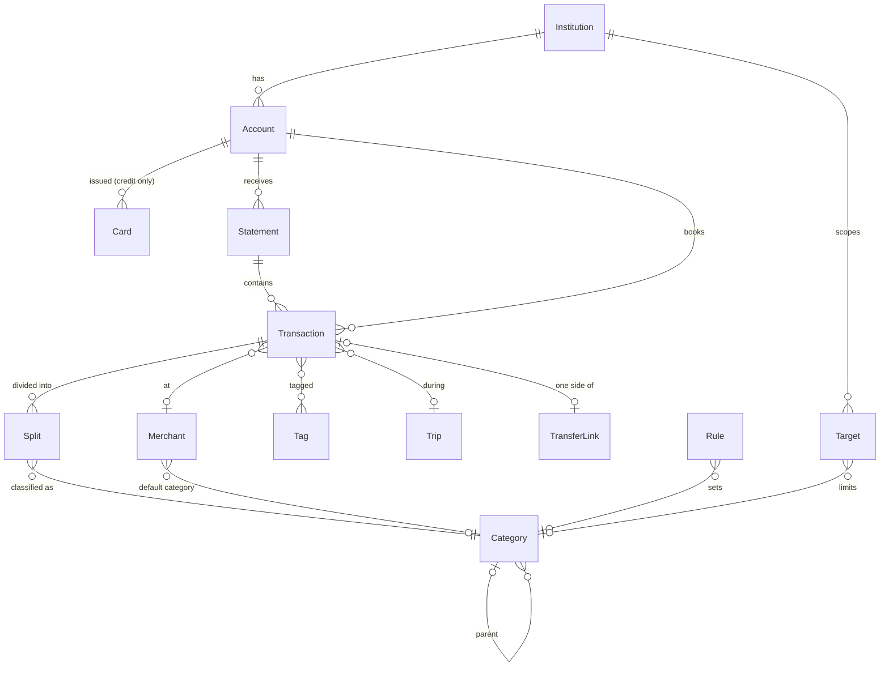

# 03 — Domain model

> Design document written before the code (October 2026). What is built: the [README](../README.md) and the
> [roadmap](08-roadmap-open-questions.md); where the plan changed, its decision log wins.

Technology-agnostic. Names in English; UI translates.

## Entities

### Institution
`id, name, country, parser_ids[]` — e.g. Desjardins (CA), LCL (FR), Cash.

**Institution = statistics scope.** All stats, dashboards and targets are computed inside one institution
(Cash is split per currency: Cash CAD, Cash EUR). Nothing is aggregated across institutions.

### Account
`id, institution_id, name, type, currency, number_masked, external_ref, opened_at, closed_at`

- `type`: `checking | savings | credit_card | cash | registered | loan`
- `external_ref`: how statements identify it. Desjardins account statement: folio + section code
  (`EOP`, `ET 1`, `ET 2`, `CS`). Card: masked account number `5598 28** **** XXXX`.
- One Desjardins account statement PDF ⇒ several Accounts (EOP, ET 1, ET 2 CELI, CS).

### Card
`id, account_id, number_masked, holder` — a card account can show several card numbers
(replacement cards, extra cards). Transactions keep which card was used.

### Statement
`id, account_id(s), institution_id, period_start, period_end, statement_date, file_hash, file_name, parser_id, parser_version,
opening_balance, closing_balance, totals{…}, imported_at, status`

- `file_hash` (SHA-256) ⇒ re-importing same PDF is detected.
- The PDF itself is **not stored**: parsed, then discarded. Provenance = statement + page + line.
- `totals` holds what the statement declares (card: previous balance, purchases, payments, new balance;
  account: carried-over balance per section) for validation.

### Transaction
Core record. One row = one money movement on one account.

| Field | Notes |
|-------|-------|
| `id` | UUID (generated on device ⇒ sync friendly) |
| `account_id` | |
| `amount` | signed integer, minor units, in **account currency**. Negative = money out |
| `currency` | = account currency |
| `original_amount`, `original_currency`, `fx_rate` | informational only, copied from statement when bank converted (card abroad). Never used for stats |
| `date` | transaction date (card: "date de transaction") |
| `posted_date` | booking date (card: "date d'inscription") |
| `raw_description` | exactly as on statement — never edited |
| `raw_code` | bank code: `ACH`, `VMW`, `PWW`, `DI`, … |
| `merchant_id` | normalized merchant (nullable) |
| `location` | city / province / country when known (card lines) |
| `note`, `tags[]`, `trip_id` | user data |
| `source` | `manual | statement | csv | …` |
| `statement_id`, `statement_line` | provenance |
| `status` | `pending_review | confirmed` |
| `kind` | `expense | income | transfer | external_transfer | refund | fee | interest` (derived, overridable) |
| `bank_hints` | e.g. Bonidollars % (3 % → groceries/restaurants per Desjardins grid) |
| `created_at, updated_at, deleted_at` | for sync |

### Split
`transaction_id, category_id, amount` — default one split = whole amount. Stats run on splits.

### Merchant
`id, display_name, default_category_id, aliases[] (patterns), logo?, website?`
- `TIM HORTONS #8517`, `TIM HORTONS #1234` → Tim Hortons.
- `COSTCO WHOLESALE W515` → Costco.
- `SQ *FERME EXEMPLE` → strip processor prefix (`SQ *`, `GDP*`, `BKG*`, `TGTG`, `Patreon*`).

### Category
Two levels, user-editable (default tree in doc 05). `id, parent_id, name_fr, name_en, icon, color, is_income, exclude_from_stats`.

### Tag
Free label. `id, name`.

### Trip
`id, name, start_date, end_date, countries[]` — transactions in date range are proposed, user confirms.
A trip can include transactions from several institutions; trip totals are still shown per institution / currency.

### TransferLink
Pairs two transactions **inside the same institution** (out on A, in on B): checking ↔ savings,
checking → card payment, bank → cash wallet (ATM). Both sides become `kind = transfer`, excluded from spending.
- Amounts equal, dates within N days.

**Transfers between institutions** (Desjardins ↔ LCL) are *not* linked (accepted limitation). Each side is a single
transaction with `kind = external_transfer`, category "Transfer to another bank", excluded from spending.

### Rule
`id, priority, conditions (description regex, code, account, amount range), actions (merchant, category, tags, kind)`.
Applied at import; user edits can create rules.

### Target
`id, institution_id (scope), category_id | group_id | null (= total spending), period (week | month | year),
amount (scope currency), start_date, active`

- Progress = sum of expense splits in scope + category for the current period.
- Week = Monday to Sunday.

No FX rate entity: no currency conversion anywhere (each scope has one currency).

## Key invariants

1. Money = integer minor units + ISO currency. No floats anywhere.
2. `raw_description` immutable; display uses merchant.
3. Sum of splits = transaction amount.
4. Spending stats = splits where `kind ∈ {expense, refund, fee}`; transfers (internal and external) and income excluded.
5. Every stat is computed inside one institution scope; no sum ever mixes currencies.
6. Credit card **purchases** count as expenses; the **payment** from checking is a transfer.
7. Imported statement rows keep link to statement; deleting a statement deletes its rows (after confirm).
