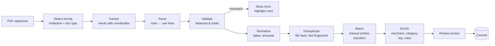

# 04 — Statement import

Findings from real Desjardins statements (Jan–Sep 2026) and exports (October 2026), then the import pipeline
design (written before the code; the built contract is under "Parser contract"). All examples below are
anonymized.

## 1. Desjardins account statement ("Relevé de compte", monthly, 2 pages)

### Structure

- Header: caisse, period `du 1er mai au 31 mai 2026`, folio, page `1 de 2`, member name/address.
- Several **sections**, each one account:
  - `EOP` — Compte pour professionnels (checking)
  - `ET 1` — Compte d'épargne (savings)
  - `ET 2` — Épargne rachetable – CELI (TFSA term deposit, rate + maturity)
  - `CS` — Part de qualification (member share)
- Table columns: `Date | Code | Description | Frais | Retrait | Dépôt | Solde`.
- First row of each section: `Solde reporté` (opening balance).

### Formats

| Item | Format | Example |
|------|--------|---------|
| Date | day + FR month abbrev, **no year** | `1 MAI`, `22 AOU`, `30 SEP` |
| Year | from statement period | `du 1er août au 31 août 2026` |
| Amount | space thousands, dot decimal | `1 753.48` |
| Negative | trailing minus | `0.01-` |
| Description | `Label / Counterparty`, may wrap to next line | `Paiement facture - AccèsD Internet / Odyssée World Elite` + `Mastercard` |

### Transaction codes seen

| Code | Meaning | Default kind |
|------|---------|--------------|
| `ACH` | Achat (debit card purchase) | expense |
| `DI` | Dépôt direct (pay, tax refund, insurance refund) | income (refund if insurer) |
| `RA` | Retrait automatique / prélèvement (insurance) | expense |
| `VMW` | Virement Interac in/out (`de` = in, `à` = out, `envoyé à` = out) | expense/income — person-to-person, often rent or shared costs |
| `VIW` | Virement AccèsD between own accounts (`à ET 1`, `de EOP`) | **transfer** |
| `PWW` | Paiement facture AccèsD (bill payment; Mastercard ⇒ **transfer**) | transfer or expense |
| `FIX` | Frais fixes d'utilisation | fee |
| `FCR` | Frais effet retourné | fee |
| `DT` / `CDT` | Fonds manquants / remboursement de frais | fee / refund |
| `IET` | Intérêt sur épargne | interest (income) |
| `IRGA` | Retrait au guichet automatique | **transfer → cash wallet** |
| Interac / wire to own account in another bank | e.g. to Wise / LCL | **external_transfer** (not linked) |
| `Annulation - …` prefix | cancellation of an earlier line | refund (link original) |

### Extraction pitfall (important)

Plain text extraction (`pdftotext`, also `-layout` / `-raw`) **does not keep amounts aligned with their row**:
the PDF draws columns as separate text blocks, so the Retrait/Dépôt/Solde values come out shifted or in a separate
run. ⇒ Parser must use **word coordinates** (x, y per word):

1. Find column x-ranges from header words (`Retrait`, `Dépôt`, `Solde`).
2. Group words into rows by y (tolerance ~2 pt); attach wrapped description lines to the previous dated row.
3. Assign each number to a column by x-position.

### Validation (strong)

Every row has a running `Solde`. For each section:
`solde[i] = solde[i-1] − frais − retrait + dépôt`. Any mismatch ⇒ row is mis-parsed ⇒ import blocked for review.
This makes the account parser self-checking. Spike: 0 balance errors on Apr–Sep 2026 (doc 09).

Spike note: column for each amount = nearest header right edge (`Frais`, `Retrait`, `Dépôt`, `Solde`); amounts are right-aligned.
Wrapped description lines (e.g. `Mastercard`) may carry the row's amounts — attach to previous dated row.

## 2. Desjardins credit card statement (Odyssée World Elite Mastercard, monthly, ~4 pages)

### Structure

- Page 1: summary — statement date (`Jour 18 Mois 09 Année 2026`), due date, previous balance,
  `Achats / débits`, `Avances d'argent`, `Frais de crédit`, `Paiements / crédits`, `Nouveau solde courant`, minimum payment.
- `DESCRIPTION DES TRANSACTIONS COURANTES`, grouped **per card**:
  `Transactions effectuées avec la carte de : <HOLDER>   Carte : 5598 28** **** XXXX`.
  Several card numbers appear across months (replacements) ⇒ same account.
- Columns: `Date de transaction (J M) | Date d'inscription (J M) | Description | City Prov | BONIDOLLARS % | Montant`.
- `TOTAL` line at end of purchases section.
- `Opérations au compte` section: payments and credits (`PAIEMENT CAISSE … CR`, `CRÉDIT VOYAGE BONIDOLLARS … CR`).
- Bonidollars summary + category grid (Épiceries 3 %, Restaurants 3 %, Divertissement 2 %,
  Transport alternatif 2 %, Voyage 2 %, Tout autre achat 1 %).

### Formats

| Item | Format | Example |
|------|--------|---------|
| Dates | `DD MM`, no year | `29 08`, `05 09` |
| Year | from statement date; **Dec→Jan rollover**: month > statement month ⇒ previous year | stmt 2026-01-18, line `28 12` ⇒ 2025-12-28 |
| Amount | space thousands, **comma decimal** | `2 948,64` |
| Credit | `CR` suffix | `2 799,20CR` |
| Foreign | extra line under purchase | `79,97 DOLLAR AMERICAIN   TX: 1.422158` |
| Location | city + 2-letter province, or phone/URL | `MONTREAL QC`, `AIRBNB.COM EN`, `Internet` |

Same extraction pitfall as above (amounts and Bonidollars columns detached from rows) ⇒ coordinate-based parsing.

### Validation

- One `TOTAL` line **per card section**; it is **net**: card purchases − refunds (`CR` lines inside the purchase section).
- Σ all debit lines (purchases + fees in `Opérations au compte`, e.g. `FRAIS ANNUELS 130,00`) = `Achats / débits`.
- Σ all `CR` lines (payments, rewards credits, merchant refunds) = `Paiements / crédits`.
- previous balance + debits − credits = new balance.

All four checks pass on Jan–Sep 2026 statements (spike, doc 09).

### Spike findings (coordinates)

- Thousands separator is a space ⇒ `2 835,60` is two words (`2` and `835,60`); merge adjacent number words.
- Columns at fixed x (PDF points): tx date ≈ 91/115, posted date ≈ 163/187, description ≈ 221, location ≈ 341,
  Bonidollars % ≈ 441, amount right-aligned ≈ 530. Use header positions, not hard-coded values, so layout shifts are tolerated.
- Foreign currency line sits right under its purchase, no date.
- Year rollover confirmed: January statement holds a payment dated `19 12` (previous year).
- `Opérations au compte` holds payments, rewards credits **and fees** (annual fee) — fees are debits.
- Several card numbers in one statement (replacement / extra cards), each with own `TOTAL`.

### Useful hints

- **Bonidollars %** is the bank's own category signal: 3 % ⇒ groceries or restaurant, 2 % ⇒ entertainment / transit / travel, 1 % ⇒ other.
  Used as weak prior for categorization (doc 05).
- City/province ⇒ location, trip detection (`GASPE QC`, `VANCOUVER BC`, foreign currency ⇒ abroad).
- `Lyft *Temp Auth Hold` — authorization holds; may be reversed later.

## 2b. Desjardins CSV export (AccèsD, preferred source)

AccèsD → *Rechercher des transactions* → *téléchargez la liste des transactions*: the last 18 months at most
(custom range possible), one file for the accounts, one for the card. No pending lines. Reader:
`packages/banks/lib/src/desjardins/csv/` (same format ids and account refs as the PDF readers).

### Structure

No header, comma-separated, descriptions **not quoted** (a comma in a merchant name makes an extra field),
dates `YYYY/MM/DD`, amounts `1234.56` without sign (withdrawal and deposit in separate columns).

| col | Account file (16 columns) | Card file (13 columns) |
|-----|---------------------------|------------------------|
| 1 | caisse name | card name + `**** <last 4 of the card used>` |
| 2–3 | folio, account code (`EOP`, `ET01`, `ET02`) | empty |
| 4–5 | date, sequence number | date, sequence number |
| 6 | description (`Achat /ACME CORP`, `Virement Interac à /PERSONNE01/`) | merchant (25 chars) + city (13) + province; longer credit lines run over |
| 7–9 | cheque (empty), withdrawal, deposit | empty |
| 10–13 | interest, capital, advance, reimbursement: empty (loans) | 12 purchase, 13 credit |
| 14–16 | empty, balance after the line, Interac message | — |

Every account of the export comes in one block; inside a block **days are oldest first but the lines of a day
newest first** (found with `banks:shape --facts`: in that order every running balance holds).

### Wording vs the PDF codes (from `banks:compare`)

| PDF code | CSV description starts with |
|----------|-----------------------------|
| ACH | `Achat /` |
| VMW | `Virement Interac à /`, `Virement Interac de /`, `Virement envoyé à /`, `Annulation - Virement Interac` |
| VIW, VIM, OUV | `Virement - AccesD Internet /à 1234567-ET1` (no accent, folio before the account), `Virement manuel`, `Ouverture de compte` |
| PWW | `Paiement facture - AccesD Internet /` |
| DI | `Paie /`, `Remboursement d'impôt /` |
| IRGA, RGP | `Retrait au GA /`, `Retrait …` (another network's ATM) |
| FIX, ADM, FCR, CDT | `Frais …`, `Remboursement des frais` |
| IET, BNI, RIS | `Intérêt sur ET`, `Boni`, `Ristourne` |
| card | `PAIEMENT CAISSE`, `CREDIT … BONIDOLLARS` (reward), merchants as on the statement |

Still unnamed (warnings): the CSV wording of RA (pre-authorized debits), some DI deposits and DT.

### Validation

- Account file: each line's balance = previous balance ± its amount, per account; a file in no line order
  where all balances hold is refused.
- Card file: no balance, nothing to check: imported **not verified** (`uncheckedFileTypes`).
- Anything outside this layout is refused: a value in a loan column, two folios or two cards in one file, a
  line with both or no amounts.
- Measured on 18 months against the PDFs: every account line found in the PDFs on the same date and amount;
  card 465 of 467 (2 lines outside the statements held).

## 3. LCL (later)

Deferred: Desjardins first. LCL provides **PDF statements**, so it gets a plug-in built on the same
architecture (detect → coordinates → parse → validate), following [doc 10](10-adding-a-bank.md). Need sample
statements when work starts. Other banks get their own section here when their plug-in is added.

Formats to expect: `DD/MM/YYYY` or `DD/MM`, `1 234,56`, debit/credit columns, `CB <MERCHANT> DD/MM` prefixes
(card payment date embedded in label), `PRLV SEPA` (direct debit), `VIR` (transfer), `RETRAIT DAB` (ATM).

## 4. Import pipeline

### Steps

1. **Detect** — by text signatures: `RELEVÉ DE COMPTE` + `CAISSE DESJARDINS` ⇒ desjardins-account;
   `ODYSSEE WORLDELITE MASTERCARD` ⇒ desjardins-card. Unknown ⇒ ask user / generic CSV mapper.
2. **Extract** — words + bounding boxes per page. Must run **on device** (Android) and on desktop: no cloud.
3. **Parse** — institution-specific parser → `RawLine{section, date_text, code, description, amounts by column, page, y}`.
4. **Validate** — see per-format rules. Fail ⇒ no silent commit.
5. **Normalize** — year inference, money to minor units, sign convention (out = negative), foreign amount extraction.
6. **Deduplicate**
   - Statement level: `file_hash`; also `(account, period)` already imported ⇒ warn.
   - Line level fingerprint: `(account, date, amount, normalized description, occurrence index)` —
     occurrence index handles two identical coffees same day (`BAR L BAROUF` ×2 on 14 09).
7. **Match**
   - Manual entries: same account (or unknown account), |amount| equal, date ±3 days ⇒ propose merge
     (manual keeps note/category, statement brings raw data).
   - Transfers: `VIW à ET 1` ↔ `VIW de EOP`; `PWW … Odyssée World Elite Mastercard` ↔ card `PAIEMENT CAISSE` (amount equal, ±5 days);
     `IRGA` ↔ cash wallet.
8. **Enrich** — rules → merchant → merchant default category → bank hint → ML/heuristic guess (later). Confidence stored.
9. **Review** — user sees counts (new / duplicate / matched / transfer / needs category), fixes, commits.

### Parser contract (built)

Each bank is a plug-in folder in `packages/banks/lib/src/<bank>/` implementing `BankImporter`: `detect(doc)` → format id or null,
`read(doc)` → bank-neutral `ImportedStatement` with its self-check results, `anonymize(doc)` → fixture-safe copy.
Kinds and category hints come from declarative `LineRule` tables. Plug-ins are registered in
`packages/banks/lib/banks.dart`. Full guide: [doc 10](10-adding-a-bank.md).

Parsers are pure functions over extracted words ⇒ easy unit tests with fixtures (words JSON, not PDFs): synthetic statements from `packages/demo`.

### Test fixtures

- Tool to turn a real PDF into **anonymized word-dump JSON**: replace names, addresses, account numbers,
  Interac counterparties; keep layout and amounts (or shift amounts consistently so balances still validate).
- Real PDFs stay outside the repo (`.gitignore`).
