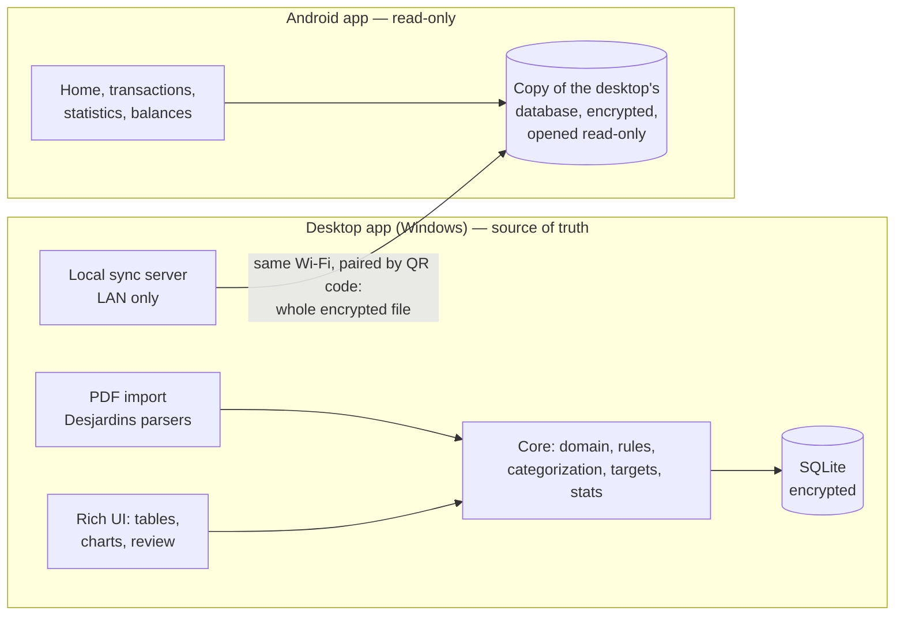

# 09 — Tech choices

> Design document written before the code (October 2026). What is built: the [README](../README.md) and the
> [roadmap](08-roadmap-open-questions.md); where the plan changed, its decision log wins.
> Changed since: bank exports (CSV) read as well as PDFs (2026-10-31); database encryption with
> SQLite3MultipleCiphers (SQLCipher 4 mode) through `package:sqlite3` build hooks, password only (2026-10-31);
> phone sync = the whole encrypted database file sent to a read-only phone app, replacing the snapshot and outbox
> below (2026-11-08, [doc 14](14-mobile.md)).

Status: **approved 2026-10-17**. Dart PDF check passed (see "Dart / PDFium check").

## Constraints (from decisions)

- **Everything runs locally.** No external API at runtime: no cloud parsing, no FX API, no aggregator, no hosted sync server.
- **Android = light**: quick entry (cash mostly), summaries, target progress, recent transactions.
- **Desktop = heavy**: PDF import, review, rules, merchants, analysis, targets management, export.
- Desjardins checking (EOP) + Odyssée Mastercard first; other Desjardins products later; LCL later.

## Spike result (2026-10-17)

Coordinate-based parsing tested with Python + pdfplumber on all real statements (5 account, 9 card):

| Statement | Lines | Validation |
|-----------|-------|-----------|
| Account (Apr–Sep 2026) | 97 lines, 4 sections each | every running balance matches (0 errors) |
| Card (Jan–Sep 2026) | 349 debits (purchases + fees), 23 credits (payments, refunds, rewards) | Σ = `TOTAL` per card, Σ debits = `Achats / débits`, Σ credits = `Paiements / crédits`, previous + debits − credits = new balance — **14/14 OK** |

Takeaways:
- Word coordinates are reliable; columns are at fixed x positions.
- Balance and total checks catch every parser bug found during the spike — validation is the safety net.
- Spike code kept as reference implementation in [`spikes/pdf-coordinates`](../spikes/pdf-coordinates/README.md).

## Proposed architecture



### Data ownership & sync (local only)

- **Desktop owns the full database.** Single source of truth ⇒ no merge conflicts to solve.
- **Phone keeps** a copy of the **whole database file** (2026-11-08): the desktop makes a `VACUUM INTO` copy
  (still encrypted with the database password) and serves it for 10 minutes on the LAN; the phone downloads it,
  checks size + SHA-256 from a signed manifest, swaps it in (two renames, recovered from `.previous` after a
  crash) and confirms. It opens the file read-only
  with the same `core` + `storage` code as the desktop, so every screen shows the desktop's figures and nothing
  has to be kept in step (the earlier plan of a snapshot of totals would have duplicated the statistics).
- **Sync** = phone and desktop on the same Wi-Fi. Pairing once with a QR code shown by desktop (addresses, port,
  pairing secret). Requests and answers signed with HMAC-SHA256 (timestamp + nonce). The file needs no extra
  transport encryption: it is the encrypted database. No internet.
- Phone works fully offline in between, on the last copy. Schema versions must match, else nothing is replaced.
- Not built: entries made on the phone. When they come, they go through an **outbox** sent to the desktop
  (backlog in doc 08); the copy stays read-only.

### PDF import location

- **MVP: desktop only.** Keeps the phone light and the parser in one runtime.
- Later option: phone receives a shared PDF and simply forwards the file to desktop at next sync (no parsing on phone).

### Stack (recommended): Flutter / Dart monorepo

| Layer | Choice | Why |
|-------|--------|-----|
| Language | **Dart** everywhere | One language, you already use it (app-comparer) |
| UI | **Flutter** — Android app + Windows desktop app | Two apps sharing the same core packages; each app has its own UI sized to its role |
| Repo tooling | melos workspace (as in app-comparer) | Known setup |
| Database | **SQLite + drift** (+ SQLCipher via `sqlcipher_flutter_libs`) | Local, encrypted, SQL for analytics, you know drift |
| PDF words + coordinates | **pdfium_dart** (PDFium FFI, open source); `pdfium_flutter` for app packaging | Verified: offline, char origin (baseline) + boxes, correct accents |
| Charts | fl_chart (or Syncfusion charts) | Local rendering, good on desktop |
| Tables (desktop) | data grid package (e.g. trina_grid / Syncfusion DataGrid) | Big sortable, editable tables |
| i18n | Flutter `intl` + ARB files (FR / EN) | Standard |
| Sync transport | Local HTTP server in desktop app (`dart:io` `HttpServer`, `packages/sync`), UDP broadcast discovery, HMAC-signed requests; the payload is the encrypted database file | No cloud; built 2026-11-08 (planned: `shelf`, mDNS, AES-GCM) |
| Tests | Dart unit tests on anonymized word-dump fixtures | Parser = pure functions over words |

Repo layout (target):

```
apps/
  desktop/            Flutter Windows app (import, review, analysis)
  mobile/             Flutter Android app (read-only viewer; quick add later)
packages/
  core/               domain model, money, categories, rules, targets, stats (pure Dart)
  storage/            drift schema + queries (desktop full DB, mobile outbox/snapshot)
  import_desjardins/  PDF word extraction adapter + account & card parsers + validation
  sync/               pairing, protocol, encryption
spikes/
  pdf-coordinates/    Python reference parser (spike, not shipped)
docs/
```

### Alternatives considered

| Option | Pros | Cons | Verdict |
|--------|------|------|---------|
| **Flutter both (Dart)** | One language, shared core, known to you, native Android + Windows | Desktop data grids/charts less mature than web | **Recommended** |
| Desktop Python (PySide6 + pdfplumber + pandas) + Android Flutter | Parser already works; strongest data tooling | Two languages, domain model duplicated, Python packaging pain | No |
| Tauri (Rust + web UI) desktop + Android Kotlin | Best desktop charts/tables (web libs), small binary | Three languages, two UIs, shared core needs Rust FFI | No (too much for a solo project) |
| Kotlin Multiplatform (Compose Android + Desktop, PDFBox) | Strong JVM PDF lib, shared core | New stack to learn, Compose Desktop smaller ecosystem | Viable fallback if Dart PDF lib fails |

## Dart / PDFium check (2026-10-17)

Flutter 3.47.7 / Dart 3.13.5 installed. Spike in [`spikes/pdf_coordinates_dart`](../spikes/pdf_coordinates_dart/README.md).

| Check | Result |
|-------|--------|
| Word rows vs Python/pdfplumber, 14 statements | **All transaction rows, totals and summary rows identical.** Only differences: page-header boxes (address, folio, statement-date box) grouped differently — Dart groups by baseline, which splits those boxes more cleanly |
| Accents | Dart/PDFium decodes `Dépôt`, `à`, `Opérations` correctly (pdfplumber gives `�`) |
| Speed | 14 statements in 1.7 s (native exe) |
| Offline | PDFium binary fetched **at build time** by the package build hook and shipped next to the exe (`pdfium.dll`). Nothing downloaded at runtime |

Lessons:
- Use `FPDFText_GetCharOrigin` (baseline) for rows and `FPDFText_GetLooseCharBox` for x extents. Tight glyph boxes
  (pdfrx `loadText`) put `.`, `-`, `'` on different y and split numbers — don't use them.
- Split words on PDFium's generated spaces + gap > 1 pt.
- Plain `dart build cli` bundle did not find its `pdfium.dll` automatically (worked with the lib folder on PATH).
  Flutter app will use `pdfium_flutter` packaging; verify when the desktop app is created.
- Statement-date header fields must be read by label position (`Jour` / `Mois` / `Année`), not by row text.

## Status

- `packages/pdf_words`: PDFium word extraction + JSON word dumps.
- `packages/import_desjardins`: account + card parsers, validation, anonymizer, CLIs. 14 anonymized fixtures, all valid.
- Workspace: Dart pub workspace (root `pubspec.yaml`); melos can be added when Flutter apps arrive.
- Android: `apps/mobile` (read-only viewer, 2026-11-08); Android SDK installed on demand by `tools\setup.ps1 -Android`
  (`build-mobile.bat`).
