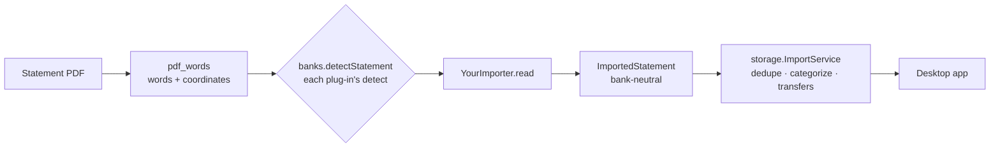

# 10 — Adding a bank

Playbook for adding a bank, or a new statement type of a bank already supported, as a **plug-in**. Written for
an AI coding agent working with the person who owns the statements, and readable by that person. Follow the
steps in order; every one ends with something you can check.

The more banks and account types the plug-ins cover, the more useful the app becomes for everyone. The rest
of the app (import, deduplication, categories, transfers, statistics, balances, recurring payments) is
bank-neutral: **a plug-in only turns a statement file (PDF or export) into the neutral `ImportedStatement`**.

**Ask first whether the bank exports transactions (CSV, OFX).** An export is far more reliable than a PDF and
needs much less code; the PDF reader is then for older months (exports often stop at 12–18 months) and a
fallback. Desjardins is the reference for both (`desjardins/pdf/`, `desjardins/csv/`).

---

## 0. Privacy rules (non-negotiable)

Bank statements are among the most personal documents there are. Before anything else:

1. **Real statements never enter the repository.** Keep them in a folder *outside* the clone (e.g.
   `../private/<bank>/`). `.gitignore` blocks `*.pdf`, `*.csv`, `*.ofx`, but don't rely on it.
2. **`banks:dump` and `banks:parse -v` print personal data** (names, addresses, account numbers, every
   transaction). Read their output locally to understand the layout. Never put it in a commit, a test,
   documentation, an issue, a pull request, a chat with someone else, or any online tool.
3. **The only statement data committed is a fixture written by `banks:anonymize`**, which refuses to
   write anything if a secret it found is still present. Still review the fixture diff before committing
   (search for the holder's name, street, employer, account digits).
4. Examples in code comments and docs are **made up**: `PERSONNE01`, `1 234,56`, `ACME CORP`. Never paste a
   real line, even "just one".
5. Agents: an agent that runs **in the cloud** (Claude Code, Codex…) sends everything it reads or prints to
   its provider. Such an agent never opens a statement, `banks:dump` or `banks:parse -v` output: it works
   from `banks:shape` and `banks:check` only (section 0b). An agent running fully on the machine (local model)
   may read the statements. Neither sends their content to external services.

### 0b. Writing a plug-in with a cloud agent, without showing it the data

A parser depends on the **layout** (columns, positions, header words, codes, date and amount formats), not on
the values. So the agent writes the code from a masked view and checks it on the real files through a report
that holds no data. Rule: **the agent never runs a command whose output contains statement data.**

| Step | Who | Command | What leaves the machine |
|------|-----|---------|-------------------------|
| 1. List words that could stay readable | owner | `dart run banks:shape --candidates ../private/mybank/reveal.txt ../private/mybank/*` | nothing (only a count is printed; refuses to write inside a git repository) |
| 2. Approve | owner | open `reveal.txt`, delete every personal word (names, street, city, employer, people, shops you'd rather hide), keep statement words (headers, codes, `SOLDE`) | nothing |
| 3. Read the layout | agent | `dart run banks:shape --reveal ../private/mybank/reveal.txt <file>` | masked text: `XXXXX 99 999,99`, positions, approved words |
| 4. Write the parser, check it | agent | `dart run banks:check --reveal ../private/mybank/reveal.txt ../private/mybank/*` | per file: format, period, line counts per kind, pass/fail of each check, unknown codes; messages masked; anything the parser prints is swallowed |
| 5. Fixtures | owner + agent | `banks:anonymize`, then the owner looks at one fixture | the fixture only |
| 6. Measure against the other source | agent | `dart run banks:compare <statements and exports, or folders>` | per account: lines paired by date and amount, unpaired per month and masked line type, PDF code → export wording, kind / merchant agreement |

The owner can do steps 1–2 without a terminal in the app: **Import → "My bank or card isn't listed"** reads the
statements, shows the candidate words as chips (all hidden until ticked), previews the masked first page and
saves `statement-N.shape.txt` / `.shape.json` + `reveal.txt` (and `notes.txt`) to a folder
(`apps/desktop/lib/screens/add_bank.dart`). `shape` and `dump` take `--out <file>` to write their output to a
file. Every tool takes folders too (statement files in them and their subfolders).

**For a CSV, start with `banks:shape --facts`**: counts and formats computed on the real file, no value —
separator, columns per line, per column (empty, constant, date format, amount, sequence), blocks of lines per
account, line order, and which column is a running balance with how many line pairs hold (it tries file
order, reversed, and per-day orders). It answers in one run what masked lines can't: the Desjardins export
lists days oldest first but the lines of a day newest first, found only this way. The add-bank page of the
app writes the same facts at the top of each shape, plus the owner's `notes.txt` (which file is which
account, what account codes mean, dates downloaded, pending lines).

`banks:shape` works on every file type: PDF (words with `x0-x1` and baseline; `--json` writes a masked word
dump the agent may parse), CSV / TXT (each line masked, separators kept), OFX / QFX (tags and header lines kept,
values masked). Lengths and the rough size of amounts still show: that is accepted.

What it doesn't protect against: an agent that ignores the rule (adds a `print` and runs the parser another way).
Claude Code gets deny rules from the repository's `.claude/settings.json`: no reading `*.pdf`, `*.csv`, `*.ofx`,
`*.qfx`, `*.qif`, `*.dump.txt`, `reveal.txt` or extra-word lists, no running `banks:dump` or `banks:parse -v`.
Add your statements folder and real database in the git-ignored
`.claude/settings.local.json` (`Read(//E:/path/to/statements/**)` and the same for `Edit` and commands naming it).
Other agents: set the equivalent. These rules don't stop a command such as `type statement.csv` or a script the
agent writes; for a hard guarantee, use a local model instead.

**Export formats are not normalized**, between countries nor between banks of one country: CSV separators,
decimal marks, date orders, Débit/Crédit columns, missing headers or account details above them; OFX 1.x (SGML)
vs 2.x (XML), merchant in `NAME` or `MEMO`, inverted card signs, unstable `FITID`. Every format goes through the
shape → check loop. Prefer an OFX or CSV export when the bank offers one (less code than a PDF). When it has
no balance column (Desjardins card), list the file type in `StatementFormat.uncheckedFileTypes`: read with no
checks, shown as not verified.

Lessons from the Desjardins CSV, worth checking on any export:
- descriptions may be unquoted and hold the separator (`ACME, INC`): join extra fields back;
- wording differs from the PDF (no transaction codes, `AccesD` without accent): rules match on the
  description, accents ignored; `banks:compare` lists which export wording each PDF code comes out as;
- use the **same format ids and account refs** as the PDF reader so both land in the same accounts;
- a card export may name the card used, the statement the card account (the app maps them, doc 11 §2);
- fixed-width fields may run over (long credit lines): don't cut text that has no location after it.

Write the bank's **`exportGuide`** (steps to download the export, FR/EN, screenshots by step number with
personal data hidden, in `apps/desktop/assets/guides/<institution>/`, folder declared under `assets:` in
`apps/desktop/pubspec.yaml`; `export_guide_test.dart` checks both): the import page shows it, and PDF imports
of the bank point to it.

**A friend with another bank**: works in a fork of the repository, uses their plug-in for a few months of
statements, then opens a pull request that touches only `packages/banks/lib/src/<bank>/`, its tests, fixtures
and the registry line. Changes to `core` / `storage` the bank seems to need go in a separate issue first.

---

## 1. What you plug into



| Package | Role | You touch it? |
|---------|------|---------------|
| `packages/pdf_words` | PDF → words with coordinates (`Word.text`, `x0`, `x1`, baseline `y`), `groupRows`, `mergeThousands` | no |
| `packages/banks/lib/plugin.dart` | The contract (`BankImporter`, `StatementFormat`), `LineRule` tables, anonymization helpers | rarely |
| `packages/banks/lib/src/<bank>/` | **Your plug-in**: detect, parse, self-check, rules, map to `ImportedStatement`, anonymize | **yes, new folder** |
| `packages/banks/lib/banks.dart` | Registry (one line per bank); CLIs `dump`, `parse`, `anonymize` in `bin/` | one line |
| `packages/banks/lib/testing.dart` | `testFixtures`: the checks every plug-in's fixtures must pass | no |
| `packages/core` | `ImportedStatement`, kinds, categories, merchant normalization | maybe (merchant aliases) |
| `packages/storage`, `apps/desktop` | Database and app, already bank-neutral | no |

### The contract (`packages/banks/lib/src/plugin/importer.dart`)

```dart
abstract class BankImporter {
  String get institution;                 // 'desjardins' — stored in the database, never change it
  String get displayName;                 // 'Desjardins'
  String get country;                     // 'CA'
  List<StatementFormat> get formats;      // every format detect() can return
  String? detect(StatementInput input);   // format id or null; cheap, never throws
  ImportedStatement read(StatementInput input);
  StatementInput anonymize(StatementInput input, {Iterable<String> extra});
}

const StatementFormat(id: 'desjardins-card', labelFr: 'Mastercard', labelEn: 'Mastercard',
    accountType: AccountType.creditCard, fileTypes: {'pdf'});
```

The app opens the file and hands every plug-in a `StatementInput` that already depends on the file type
(`packages/banks/lib/src/plugin/input.dart`):

| File | Input | What you get |
|------|-------|--------------|
| `.pdf` | `PdfInput` | `words`: every word with its coordinates (see step 2) |
| `.csv`, `.ofx`, `.qfx`, `.qif`, `.txt` | `TextInput` | `text` (UTF-8, or Windows-1252 when not valid UTF-8), `lines`, `fileType` |

`detect` looks at the type first, so one bank can read several kinds of files:

```dart
@override
String? detect(StatementInput input) => switch (input) {
  PdfInput(:final words) => isMyBankPdf(words) ? checking.id : null,
  TextInput(fileType: 'csv', :final lines) => lines.first.startsWith('Date;Libellé;Montant') ? checking.id : null,
  _ => null,
};
```

**A format id is a statement type, not a file type.** If the bank offers the same checking statement as PDF and
CSV, both readers return `mybank-account` and the format lists `fileTypes: {'pdf', 'csv'}`: a month imported
from either file counts as covered. The lines must then come out identical (same date, amount and
description) from both readers, otherwise importing the PDF and the CSV of the same month duplicates them —
or document that one file type per account should be used.

### What `read` returns (`packages/core/lib/src/imported.dart`)

| Field | Rule |
|-------|------|
| `institution` | Your plug-in's `institution`. |
| `format` | One of your `formats` ids, `<institution>-<kind>`. Stored with each statement; never rename. |
| `periodStart`, `periodEnd` | UTC dates, inclusive. The app uses them to find missing months. |
| `coversSincePrevious` | `true` when the statement only prints its closing date (common for cards): it then covers the days since the previous statement of that format, and `periodStart` is an estimate. |
| `accounts` | One per account listed: `ref` (stable id **inside the bank**, e.g. a product code `EOP` or `card-<last 4>`, never a full account number), `name`, `type` (`checking`, `savings`, `registered`, `creditCard`, `share`), `currency` (ISO, **one per account**), `closingBalance` (cents, credit card owed = negative). |
| `lines` | One per transaction, see below. |
| `failedChecks`, `checkCount` | Self-checks, see step 5. A statement with a failed check is refused by the app. |

Each `ImportedLine`:

| Field | Rule |
|-------|------|
| `accountRef` | The `ref` of the account the line belongs to. |
| `date` | Transaction date, `DateTime.utc(y, m, d)`. `postedDate` if the statement prints both. |
| `amount` | **Integer cents**, signed from the account's point of view: money out < 0, money in > 0. Never use `double` for money. |
| `description` | Exactly as printed (wrapped lines joined with a space). |
| `merchantText` | The part naming the merchant or the person: strip bank prefixes (`CB `, `PRLV SEPA `, `Achat / `), card dates, references. The app normalizes it further. |
| `kind` | See the table below. **The most important field**: it decides what counts as spending. Comes from your rules table (step 6). |
| `categoryHint` | When the bank's format implies a category (fees, salary, interest, card payment…): one of the ids below. |
| `isPerson` | `true` for transfers to or from a person (Interac, Lydia, Wero, PayPal friends…). People are counted in their category but never ranked as merchants nor exported. |
| `code` | The bank's transaction code if it has one. |
| `card`, `location`, `foreignCents`, `foreignCurrency`, `fxRate`, `bonusRate` | Optional, when printed. |

| `TransactionKind` | Use for | Counts as |
|-------------------|---------|-----------|
| `expense` | Purchases, bills, rent, money sent to people | spending |
| `refund` | Money back for an earlier expense (merchant refund, cancelled transfer) | negative spending |
| `fee` | Bank fees | spending |
| `income` | Salary, tax refund, reimbursements, deposits, rewards | income |
| `interest` | Interest earned, savings bonuses | income |
| `transfer` | Between two accounts **of the same bank** (checking ↔ savings, card payment from checking, ATM withdrawal) | nothing |
| `externalTransfer` | To or from another bank (including your own account elsewhere) | nothing |

Category hints the app knows (full tree in `packages/core/lib/src/category.dart`):
`excluded.internal_transfer`, `excluded.card_payment`, `excluded.cash_withdrawal` (also credits the cash wallet),
`excluded.savings`, `excluded.external_transfer`, `finance.bank_fees`, `finance.interest_paid`,
`income.salary`, `income.tax_refund`, `income.insurance_refund`, `income.interest`, `income.reimbursements`,
`income.rewards`, `income.other`, `people.sent`, `housing.rent`. Anything else is left to the categorizer.

**Unknown codes are the classic trap.** If a code isn't mapped, the line falls back to `expense` (money out) or
`refund` (money in), and a cheque deposit silently lowers your spending. That's why kinds come from a rules table
(step 6): an unmapped line is reported as a warning by `banks:parse` and fails the fixture tests.

---

## 2. Collect and read statements

1. Gather, outside the repository, **several months of each statement type**, including if possible: a
   December + January (year rollover), a multi-page month, a refund, a fee, a foreign-currency purchase, a
   transfer between your accounts, a card payment, a month with almost nothing, an old statement (layouts
   change over the years).
2. See them the way your reader will (scanned/image PDFs have no text and are out of scope for now):

   ```sh
   dart run banks:dump ../private/mybank/2026-09.pdf > ../private/mybank/2026-09.txt
   dart run banks:dump ../private/mybank/export-2026-09.csv     # text exports: numbered lines, as decoded
   ```

   **Text exports (CSV, OFX…)** are simpler: find the header line (column names), the separator (`;` or `,`),
   the decimal mark, the date format, how debits/credits are told apart (sign, two columns, a `D`/`C` column),
   and whether a balance column exists (it gives the self-checks). OFX is XML-like (`<STMTTRN>` blocks with
   `<DTPOSTED>`, `<TRNAMT>`, `<NAME>`, `<MEMO>`, and `<LEDGERBAL>`).

   For a **PDF**, each output row is `y=<baseline> | <x>:<word> <x>:<word> …`. Read it next to the PDF:
   - **Detection**: a phrase on page 1 that only this statement type has (product name, title).
   - **Header**: period / statement date, holder, account numbers (to anonymize), currency.
   - **Table columns**: the header row and the x range of each column (date, label, debit, credit, balance).
     Amounts are usually right-aligned: use the right edge `x1`.
   - **Formats**: date (`12/09`, `12 SEP`, no year?), amount (`1 234,56`, `1,234.56`, trailing `-`, `CR`),
     how a description wraps, page headers and footers repeated on each page.
   - **Totals you can check**: opening/closing balance, running balance per line, total debits/credits, per-card
     totals. These become the self-checks.
3. Write down codes and labels: every transaction code or label prefix and what it means (purchase, direct
   debit, transfer in/out, ATM, fee, interest, salary, card payment…).

---

## 3. Document the format (anonymized)

Add a section to `docs/04-statement-import.md` like the Desjardins ones: structure, formats table, codes table
with the kind each maps to, validation rules, pitfalls. Made-up examples only. This is what the next person
(or agent) reads when the bank changes its layout.

---

## 4. Create the plug-in folder

Every bank lives in one folder of the `banks` package — no new package, no workspace edit:

```
packages/banks/
  lib/banks.dart                       # registry: add one line here
  lib/plugin.dart                      # the contract + helpers your files import
  lib/src/mybank/
    importer.dart                      # MyBankImporter implements BankImporter
    detect.dart                        # format detection from page 1
    <format>_parser.dart               # one parser per statement type
    rules.dart                         # LineRule tables: code / label -> kind, hint (step 6)
    to_core.dart                       # parsed statement -> ImportedStatement
    anonymizer.dart
    README.md                          # what is parsed and checked, codes, limits
  lib/mybank.dart                      # optional: exports parser API for tests
  test/mybank/importer_test.dart       # testFixtures(...)
  test/mybank/<format>_parser_test.dart
  test/fixtures/mybank/*.synthetic.json  # preferred: written by demo:fixtures (packages/demo, no real data)
  test/fixtures/mybank/*.anon.json     # or anonymized real statements, written by banks:anonymize only
  test/fixtures/mybank/*.anon.csv      # text-export fixtures (same tool)
```

Register it in `packages/banks/lib/banks.dart`:

```dart
import 'src/mybank/importer.dart';

const List<BankImporter> banks = [
  // One line per bank, in alphabetical order:
  DesjardinsImporter(),
  MyBankImporter(),
];
```

Importer skeleton (`lib/src/mybank/importer.dart`):

```dart
import '../../plugin.dart';
import 'anonymizer.dart' as anonymizer;
import 'detect.dart';
import 'to_core.dart';

class MyBankImporter extends BankImporter {
  const MyBankImporter();

  @override
  String get institution => 'mybank';
  @override
  String get displayName => 'MyBank';
  @override
  String get country => 'FR';

  static const checking = StatementFormat(
    id: 'mybank-account', labelFr: 'compte MyBank', labelEn: 'MyBank account', accountType: AccountType.checking);

  @override
  List<StatementFormat> get formats => const [checking];

  @override
  String? detect(StatementInput input) => switch (input) {
    PdfInput(:final words) => isMyBankAccountStatement(words) ? checking.id : null,
    _ => null,
  };

  @override
  ImportedStatement read(StatementInput input) => switch (input) {
    PdfInput(:final words) => toImported(parseAccountStatement(words)),
    _ => throw FormatException('MyBank: no reader for ${input.fileType} files'),
  };

  @override
  StatementInput anonymize(StatementInput input, {Iterable<String> extra = const []}) => switch (input) {
    PdfInput(:final fileName, :final words) => PdfInput(fileName, anonymizer.anonymize(words, extra: extra)),
    _ => throw FormatException('MyBank: no reader for ${input.fileType} files'),
  };
}
```

`lib/src/desjardins/` is the reference implementation: copy its structure, not its rules.

---

## 5. Parse and self-check

- **Work on coordinates, not on text flow.** `groupRows(page.words)` gives rows by baseline; find the column
  header row, remember each column's x range, then assign every amount word to a column by its `x1`. Text
  order inside a PDF is not reliable (amounts can come before labels).
- **Dates**: build `DateTime.utc`. When lines have no year, infer it from the period (a December line on a
  January statement belongs to the previous year).
- **Amounts**: parse to integer cents (`'1 234,56'` → `123456`). Merge thousands split into two words
  (`mergeThousands`).
- **Wrapped descriptions**: a row without date that is x-aligned with the description column, on the same
  page and close below, continues the previous line. Page headers and footers must never be glued on.
- **Self-checks are mandatory** (`checkCount > 0`). Use whatever the bank prints: each running balance
  (`previous + amount == printed`), opening + sum of lines == closing, total debits/credits, per-card totals.
  Put a readable message in `failedChecks` for each mismatch (no personal data in it). A statement that fails is
  refused by the app: that's how layout changes get caught instead of silently importing wrong numbers.
- `detect` reads page 1 only and returns null for anything else — it runs on every file for every bank.
- `read` throws `FormatException` when the layout can't be understood at all.
- **When the bank changes its layout**, keep the old parser (old statements still get imported) and add one
  per layout, picked from page 1, newest first — see `cardLayouts` in `desjardins/pdf/detect.dart`. Every layout
  returns the same model, so format id, account refs and merchant names stay the same. Detect a layout by
  something only that statement type prints (Desjardins account statements also print the card's name), and
  read page 1 row by row (`groupRows`), not in the PDF's word order.

Quick loop while developing:

```sh
dart run banks:parse ../private/mybank/*.pdf        # summary per file: VALID / INVALID, counts
dart run banks:parse -v ../private/mybank/2026-09.pdf   # every line with kind and hint (personal data!)
```

Go through `-v` output line by line: every kind must be right. Run it on **all** your statements.

---

## 6. Map lines with a rules table

Return your tables from `BankImporter.lineRules` too: their wording is kept in anonymized developer copies.

Don't write the code → kind logic as `if`s or a `switch`: declare it as a table of `LineRule`s
(`packages/banks/lib/src/plugin/rules.dart`), one row per code or label pattern. The first matching row wins, so
put specific rows (a code with a description) before general ones (the code alone):

```dart
const accountRules = [
  LineRule(codes: {'VIR'}, contains: 'MON LIVRET', kind: TransactionKind.transfer, hint: 'excluded.internal_transfer'),
  LineRule(codes: {'VIR'}, direction: Direction.moneyIn, kind: TransactionKind.income, hint: 'income.other'),
  LineRule(codes: {'PRLV'}, kind: TransactionKind.expense),
  LineRule(codes: {'CB'}, direction: Direction.moneyOut, kind: TransactionKind.expense),
  LineRule(codes: {'CB'}, direction: Direction.moneyIn, kind: TransactionKind.refund),
  LineRule(startsWith: 'FRAIS', kind: TransactionKind.fee, hint: 'finance.bank_fees'),        // no code: label only
  LineRule(section: 'operations', startsWith: 'PAIEMENT', kind: TransactionKind.transfer, hint: 'excluded.card_payment'),
];
```

| `LineRule` field | Matches when |
|------------------|--------------|
| `codes` | the line's code is one of them (empty = any) |
| `section` | the parser passed this section name (e.g. a card statement's `operations` / `purchases`) |
| `startsWith`, `contains` | the description starts with / contains the text (case-insensitive) |
| `direction` | `moneyOut` (amount < 0), `moneyIn` (> 0), `any` |

It yields `kind`, `hint` (category id) and `isPerson`. In `to_core.dart`, create one `LineClassifier(rules)` per
statement, call `classify(code:, section:, description:, amount:)` for each line, and pass
`classifier.warnings` to `ImportedStatement(warnings: …)`. Lines no row matches fall back to expense / refund and
show up as `unknown code XYZ (3 lines)` in `banks:parse` — add a row, never leave a warning. Purchases are rows
too (e.g. `section: 'purchases'`, by direction), so "unmatched" always means "not understood yet".

Adding a code later (a new statement shows a warning) is one row in the table plus a line in the docs table
(step 3). See `lib/src/desjardins/pdf/to_core.dart` (`accountRules`, `cardRules`).

---

## 7. Anonymize and make fixtures

Your `anonymize` returns a copy of the word dump with personal data replaced and **everything the parser
needs kept** (layout, dates, amounts, merchant names, codes):

- holder name (everywhere) and postal address;
- account, IBAN, card, contract, customer numbers (`mask` keeps the shape: `FR76 1234…` → `XX99 9999…`);
- names of people in transfers (`PERSONNE01`, consistent within the file);
- references (`isReference`), long numbers (`isLongNumber`), every word of `extra`;
- finish with `verifyAnonymized(result, secrets)`: it throws `AnonymizationLeak` if a secret remains.

Then:

```sh
dart run banks:anonymize --out packages/banks/test/fixtures/mybank \
    --extra ../private/mybank/extra.txt ../private/mybank/*.pdf
```

`extra.txt` (outside the repo, one word per line): employer, landlord, insurance policy number, anything
personal your anonymizer can't guess. A fixture is written only if the original validates, no secret remains,
and the anonymized copy reads to exactly the same dates, amounts, kinds and checks. Files are named
`<format>-YYYY-MM.anon.json` (PDF) or `<format>-YYYY-MM.anon.<csv|ofx…>` (text export; end its anonymizer
with `verifyTextAnonymized`). Open one and search it for the holder's name and street before committing.

Anonymized fixtures still carry real merchants, places, dates and amounts. For a repository others can read,
prefer synthetic ones: add the bank's layout to `packages/demo` (a writer like `src/desjardins/`, fed by the
made-up household), check in `demo`'s tests that the plug-in reads every written statement back, and run
`dart run demo:fixtures`. Desjardins works this way since 2026-10-31. `.gitignore` leaves `*.anon.*` out: commit
one on purpose with `git add -f`, after review.

---

## 8. Tests

`packages/banks/test/mybank/importer_test.dart`:

```dart
import 'package:banks/src/mybank/importer.dart';
import 'package:banks/testing.dart';

void main() => testFixtures(const MyBankImporter(), 'test/fixtures/mybank');
```

`testFixtures` checks, for every fixture: marked anonymized, detected as the format in its file name, read
without failed checks and without warnings (every line matched a rule), at least one check, lines belong to
declared accounts, non-zero amounts, dates near the period, category hints that exist.

Add parser tests on fixtures for what matters: period, opening/closing balances, number of lines, a few
lines with their date, amount, kind and hint, the year rollover, a refund, a wrapped description.

Run everything: double-click `test-all.bat` (or `powershell -File tools	est-all.ps1`). It checks
formatting, analysis and every test, including a smoke test that opens every page of the app on all banks'
fixtures. GitHub runs the same script on the pull request.

---

## 9. Try it in the app

Never on the statement owner's real database: use a scratch folder.

```bat
cd apps\desktop
flutter build windows --release --no-tree-shake-icons
rem An empty folder: the app creates its database there instead of the usual one
rem (it asks to choose a password for it: any test password of 17+ characters).
set EXPENSES_DB_DIR=C:\temp\mybank-test
build\windows\x64\runner\Release\expense_desktop.exe
```

Import the real PDFs, then check: no "not recognized" or "invalid" file; the coverage grid (Import page) shows
each month; card payments from checking pair with the card's payment (both `transfer`); salary in income;
fees; Statistics totals per month look right; balances (Statistics → Balances) end on the printed closing
balance.

---

## 10. Pull request

Branch `bank/<institution>`, conventional commits (`feat(banks): add MyBank checking statements`). The PR description lists the
statement types and the period tested (e.g. "checking 2024-01 → 2026-09, 33 statements, all valid"), never
real content. Checklist (also in `.github/pull_request_template.md`):

- [ ] No PDF, CSV, dump output or real value anywhere in the diff; fixtures only from `banks:anonymize`,
      searched for the holder's name, street and account digits.
- [ ] `institution` and format ids are new, lower case, `<institution>-<kind>`; nothing existing renamed.
- [ ] Every code / label prefix seen is a `LineRule` row (no warning from `banks:parse`); listed in
      `docs/04-statement-import.md`.
- [ ] Self-checks cover every amount (running balances or totals); `banks:parse` VALID on all statements.
- [ ] Tests pass in every package; `flutter analyze` clean.
- [ ] Tried in the app on a scratch database.
- [ ] `lib/src/<bank>/README.md`: statement types, checks, known limits.

---

## When the contract is not enough

- **Another file type** (XLSX, JSON…): add it to `statementFileTypes` and to `loadStatementInput`
  (`packages/banks/lib/files.dart`) in the same pull request, with a test.
- **Accounts in several currencies at one bank**: supported (one statistics scope per currency); each account
  still has exactly one currency.
- **A new account type, kind or category**: changes in `core` affect every bank and stored data. Discuss in an
  issue; existing ids are never renamed (see `retiredCategories` and the migrations in `storage`).
- **Merchant names your bank decorates** (`CB CARREFOUR 12/09`, `PAYPAL *SHOP`): strip bank-specific prefixes
  in your `to_core.dart` (`merchantText`); add widely useful merchants to `merchantAliases` and payment
  processors to `_processors` in `packages/core/lib/src/merchant.dart`.
