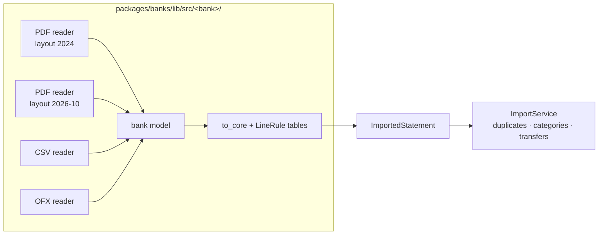

# 11 — Import sources and bank onboarding

How statements from many banks, file types and layouts reach the app without refactoring it each time, how
duplicates across file types are caught, and how people who never code can get their bank supported. Decided
2026-10-25; sections marked **later** are recorded ideas, not planned work.

---

## 1. One neutral representation, many readers

The app already consumes a single intermediate representation: **`ImportedStatement`**
(`packages/core/lib/src/imported.dart`). Everything after it (import, duplicates, categories, transfers,
coverage, statistics) is bank-neutral. Adding a bank, a file type or a new layout only adds a **reader**:

| Variation | Where it lives | Example |
|-----------|----------------|---------|
| Bank | one plug-in folder + one registry line | `desjardins/`, later `lcl/` |
| Statement type | one `StatementFormat` id `<institution>-<kind>` | `desjardins-account`, `desjardins-card` |
| File type of the same statement | another reader returning the **same format id** | Desjardins account as PDF and CSV |
| Layout change | another reader, picked from page 1, newest first | `cardLayouts` in `desjardins/pdf/detect.dart` |
| Country (date / amount formats, codes) | inside the readers and rules table | French `1 234,56`, `12/09` |

Rules every reader of one statement type must follow, so sources stay interchangeable:

- same format id, same account `ref` (e.g. `EOP`, `card-1234`), same currency;
- same date meaning: the transaction date (not the posting date) when the bank gives both;
- same sign convention (money out < 0) and integer cents;
- same `kind` / `hint` for a given operation: the rules table is shared, not copied per file type.

The description may differ between sources (a CSV often shortens or reformats it). That is what breaks
today's duplicate detection (section 2).

Not needed now: a second intermediate layer between readers and `ImportedStatement`. Each bank's own model
(`desjardins/pdf/model.dart`) already plays that role inside its plug-in; a shared one would have to cover every
bank's quirks and would change each time a bank is added.

---

## 2. Duplicates

### What is caught today (`packages/storage/lib/src/import_service.dart`)

| Check | Catches |
|-------|---------|
| `sameFile` — SHA of the file | the same file dropped twice, even renamed |
| `sameStatement` — same format id + same `periodEnd` | the same statement downloaded again (different bytes) |
| `sameLines` — every line fingerprint already known | the same lines exported again |
| per line `lineFingerprint` (institution, account, date, amount, **description**, occurrence) | overlapping statements: known lines skipped, new ones added |

Two PDFs of the same statement: caught.

### The gap: PDF + CSV (or OFX) of the same month

- A CSV export covers the dates the user picked, so its `periodEnd` rarely equals the PDF's → `sameStatement`
  misses it.
- The fingerprint includes the description; the CSV's wording differs from the PDF's → every line looks new
  → **the month is counted twice**.

### Fix (backlog B30, done 2026-10-31, schema v8)

1. Store each statement's file type (`statements.file_type`, schema migration; existing rows = `pdf`).
2. On import, find earlier statements of the **same account** whose period overlaps the new one, from any
   file type.
3. Inside the overlapping days, match lines by **(account, date, amount)** as a multiset, description ignored.
   Matched lines are duplicates; the line already stored is kept (it may be reviewed and categorized).
4. Lines of the overlap that match nothing are **not imported silently**: they are imported and the import
   result counts them ("N new lines on days already imported from another file were not found there: check
   them in Transactions"). Fail loud, never guess.
5. Days outside every earlier period import normally.
6. Coverage: a CSV covering part of a month marks only those days; the month is "covered" when its days are.

Checked on real Desjardins files with `banks:compare` (counts only): the CSV uses the same dates as the PDFs
(account, savings and card), so matching is exact, no ±1 day.

7. A card export may name the **card used** where the statements name the **card account**
   (Desjardins: `card-<last 4>` of the card vs of the account). A new card ref is matched to the card account
   whose lines name that card, both ways (`ImportService._sameCardAccount`).
8. A text export's period doesn't identify a statement (two downloads on one day end on the same date): for
   text exports the `sameStatement` guard is skipped, only lines are compared.

Same-source re-imports keep using the fingerprint with description (exact, already proven).

---

## 3. Onboarding a bank for people who never code

Target: friends who never code, with a bank or card the app doesn't read.

### Now (backlog B31, done 2026-10-25)

1. **Import screen lists what is supported**: bank, statement types, file types (from the registry's
   `formats`). A user knows at once whether their bank is covered.
2. **"My bank isn't listed"** opens a guided page in the app (the drag-and-drop `bank-tools\*.bat` it replaced
   were removed 2026-10-31): drop statements → the candidate words show as chips, **all hidden until ticked** (the
   holder's name and street are in every statement, so they are candidates too) →
   preview of the masked view → save the masked files to a folder. Nothing leaves the machine; the user
   sends that folder to whoever writes the plug-in (today: the repository owner, with an agent).
3. The plug-in is still written in Dart and shipped in the next build.

### Later (not planned)

- **Declarative bank formats loaded at runtime** (no rebuild): a versioned file per statement type
  describing detection words, CSV / OFX columns or PDF table columns, date and amount formats, `LineRule`
  table and **mandatory self-checks**; tested in the app on the user's files (pass / fail, no data shown)
  before being installed. Declarative only, never scripts: a file from a stranger must not run code next to
  bank data.
  Start condition: at least two banks written in Dart (Desjardins + LCL) to extract the common part from
  real cases, and real demand from people outside the repository. Desjardins stays in Dart (its layouts use
  logic a format file can't express without becoming a language).
- **Package for an AI assistant**: the masked folder plus a prompt and the format schema, for a user who
  wants to write the format with a chat assistant themselves. Weak until the format files exist and the
  in-app test gives quick feedback: the shape → write → check loop takes many rounds.

---

## 4. Open questions

- Which file type wins in the coverage grid label when a month has both a PDF and a CSV? (Proposal: show
  both icons; coverage only cares that days are covered.)
- ~~A CSV has no balances for some banks~~: decided 2026-10-31, imported "not verified" (the format lists the
  file type in `uncheckedFileTypes`; the import result says so).
